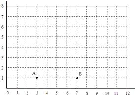

# Mathematics (Grade 5)

**ID**: 52a561d0
**难度**: medium_hard
**题型**: multiple_choice

## 题目
观察如图，再找一找下面的哪个数对表示的点和A，B连接起来后不能形成一个等腰三角形．(  )

A．(5，2)
B．(6，3)
C．(5，7)
D．(3，5)

## 解答

**答案**: B

1. Step1:分析若AB为底边的情况，得出能与AB围成等腰三角形的点都在线段AB的垂直平分线上，其坐标形式为(5，a)。
2. Step2:分析若AB为腰的情况，得出第三个点的坐标可能是(3，5)或(7，1)等。
3. Step3:逐一分析选项，A选项(5，2)符合(5，a)形式，有可能构成等腰三角形；C选项(5，7)符合(5，a)形式，有可能构成等腰三角形；D选项(3，5)是AB为腰时的可能坐标，能构成等腰三角形；B选项(6，3)既不符合(5，a)形式，也不是AB为腰时的可能坐标，不能构成等腰三角形。
4. Step4:得出答案为B选项

## 知识点

**知识点**:
  - 数对与位置．

---
