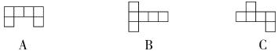

# Mathematics (Grade 5)

**ID**: 53a33b80
**难度**: medium_hard
**题型**: multiple_choice

## 题目
下面图形中不是正方体表面展开图的是（）。

## 解答

**答案**: A

1. Step1:明确题目要求是找出不是正方体表面展开图的图形
2. Step2:分析图A，其横排的四个正方形能围成正方体的四个面，但另外两个正方形在同一旁，根据正方体表面展开图特征，不能围成正方体的另外两个面
3. Step3:分析图B，横排的四个正方形能围成正方体的四个面，另外两个正方形在这四个正方形的两旁，能围成正方体的另外两个面
4. Step4:分析图C，横排的四个正方形能围成正方体的四个面，另外两个正方形在这四个正方形的两旁，能围成正方体的另外两个面
5. Step5:综上，不是正方体表面展开图的是图A，答案为A

## 知识点

**知识点**:
  - 长、正方体的展开与折叠

---
