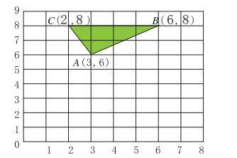

# Mathematics (Grade 5)

**ID**: 53c649fe
**难度**: medium_hard
**题型**: multiple_choice

## 题目
在下面平面图中，点A的位置用数对表示为（3，6），点B的位置用数对表示为（6，8），点C的位置用数对表示为（2，8），则三角形ABC一定是（）。

A.锐角三角形
B.直角三角形
C.钝角三角形
D.任意三角形

## 解答

**答案**: C

1. Step1:明确已知条件，点A的位置用数对表示为（3，6），点B的位置用数对表示为（6，8），点C的位置用数对表示为（2，8），要判断三角形ABC的形状
2. Step2:根据三角形的分类方法，需要找出三角形的最大角
3. Step3:观察图中三点的位置，确定三角形的最大角
4. Step4:判定这个最大角是钝角
5. Step5:根据钝角三角形的定义，得出三角形ABC是钝角三角形，所以答案选C

## 知识点

**知识点**:
  - 用数对确定位置;三角形的分类

---
