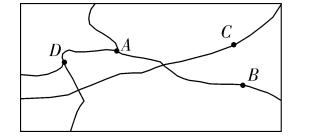

# Mathematics (Grade 5)

**ID**: 53fa8f74
**难度**: medium_hard
**题型**: multiple_choice

## 题目
A、D两地的实际距离是20km（如下图），那么A、B两地的实际距离大约是（）。

A.30km
B.50km
C.100km
D.120km

## 解答

**答案**: B

1. Step1:观察图形，确定AB的距离是AD距离的2.5倍
2. Step2:已知A、D两地实际距离为20km
3. Step3:根据求一个数的几倍用乘法计算，用AD的实际长度20km乘2.5，即20×2.5
4. Step4:计算得出20×2.5 = 50km，所以A、B两地的实际距离大约是50km
5. Step5:从选项中找出50km对应的选项B

## 知识点

**知识点**:
  - 小数乘法

---
