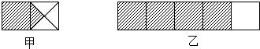

# Mathematics (Grade 5)

**ID**: 56cac43a
**难度**: medium_hard
**题型**: multiple_choice

## 题目
下面甲乙两图中的每个方格同样大，乙图的阴影部分是甲图阴影部分的（  ）
倍．

A．$\frac{16}{5}$
B．$\frac{5}{16}$
C．$\frac{4}{5}$
D．$\frac{3}{2}$

## 解答

**答案**: A

1. Step1:根据条件每个方格同样大且每个方格按平均分成4份计算，数出甲图阴影部分的份数为5份
2. Step2:同样根据上述条件，数出乙图阴影部分的份数为16份
3. Step3:根据求一个数是另一个数的几倍用除法，用乙图阴影部分的份数16除以甲图阴影部分的份数5，即16÷5
4. Step4:得出16÷5的结果为$\frac{16}{5}$，所以乙图的阴影部分是甲图阴影部分的$\frac{16}{5}$倍，答案选A

## 知识点

**知识点**:
  - 分数的意义、读写及分类；组合图形的面积．

---
