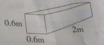

# Mathematics (Grade 5)

**ID**: 58b7aad4
**难度**: medium_hard
**题型**: multiple_choice

## 题目
如图所示的长方体，把它分成两个完全相同的小长方体，表面积至少增加（  ）平方米。
 A． 0.36
 B、0.18
 C．0.72

 0.6m  2m   0.6m

## 解答

**答案**: C

1. Step1:明确将长方体分成两个完全相同的小长方体后，表面积会增加两个面
2. Step2:分析得出当横截面是0.6×0.6时，表面积增加得最少
3. Step3:计算增加的表面积，即0.6×0.6×2=0.72平方米
4. Step4:根据计算结果，答案选C

## 知识点

**知识点**:
  - 

---
