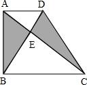

# Mathematics (Grade 5)

**ID**: 62055501
**难度**: medium_hard
**题型**: multiple_choice

## 题目
梯形中面积相等的三角形有（  ）

A．1对
B．2对
C．3对
D．4对

## 解答

**答案**: C

1. Step1:根据梯形的特点，发现△ABC和△BCD是同底（BC）同高的三角形，所以$S_{△ABC}$=$S_{△BCD}$
2. Step2:发现△ABD和△ADC是同底（AD）同高的三角形，所以$S_{△ABD}$=$S_{△ADC}$
3. Step3:因为$S_{△ABD}$=$S_{△ADC}$，等式两边同时减去$S_{△AED}$，即$S_{△ABD}$-$S_{△AED}$=$S_{△ADC}$-$S_{△AED}$，从而得到$S_{△AEB}$=$S_{△CED}$
4. Step4:统计面积相等的三角形对数，有$S_{△ABC}$=$S_{△BCD}$，$S_{△ABD}$=$S_{△ADC}$，$S_{△AEB}$=$S_{△CED}$，共3对

## 知识点

**知识点**:
  - 三角形的周长和面积．

---
