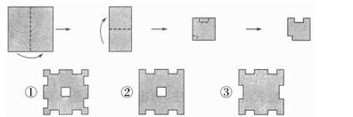

# Mathematics (Grade 5)

**ID**: 64716e88
**难度**: medium_hard
**题型**: multiple_choice

## 题目
将一张正方形纸片按下图所示的方式依次对折后，再沿图中的虚线裁剪，最后将纸片打开铺平，所得的图案应该是下面图案中的（）。

## 解答

**答案**: ②

1. Step1:观察题目可知，是对正方形纸片进行依次对折、裁剪后判断展开图案
2. Step2:根据图形对折特点，正方形经过两次对折后得到一个小正方形，此小正方形有4张小正方形的厚度
3. Step3:在小正方形上端剪掉一个小长方形，那么打开平铺后会缺少4个小长方形
4. Step4:因为左下角减掉的是正方形，且是原正方形的中心位置，所以展开后正方形已不含‘中心’，即中间部分空缺一个正方形图案，可排除③
5. Step5:观察图形可知展开后正方形上下两边各有两个缺口，左右两边没有缺口，可排除①
6. Step6:综上，所得图案应该是②

## 知识点

**知识点**:
  - 平面图形的折叠(奥数)

---
