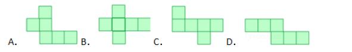

# Mathematics (Grade 5)

**ID**: 68f8392e
**难度**: medium_hard
**题型**: multiple_choice

## 题目
下面的图形中，有一个不是正方体的展开图，它是（）

## 解答

**答案**: A

1. Step1:明确正方体展开图常见类型有“141型”、“132型”、“222型”、“33型”
2. Step2:分析选项A，发现其折叠后第一行和第三行两个面无重叠，下边没有面，不符合正方体展开图类型，不能折成正方体
3. Step3:分析选项B，其属于正方体展开图类型，折叠后可以围成正方体
4. Step4:分析选项C，其属于正方体展开图类型，折叠后可以围成正方体
5. Step5:分析选项D，其属于正方体展开图类型，折叠后可以围成正方体
6. Step6:综上，不是正方体展开图的是A

## 知识点

**知识点**:
  - 长、正方体的展开与折叠

---
