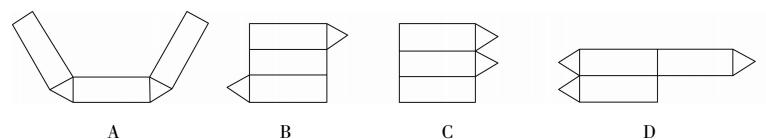

# Mathematics (Grade 5)

**ID**: 6c304b15
**难度**: medium_hard
**题型**: multiple_choice

## 题目
下列图形中，能通过折叠围成一个三棱柱的是（）     

## 解答

**答案**: B

1. Step1:明确三棱柱展开图特征为有2个相同的三角形和3个矩形，选项A、B、C符合此数量特征，D有3个三角形不符合，先排除D
2. Step2:分析选项A，折叠后有二个侧面重合，不能得到三棱柱，排除A
3. Step3:分析选项B，折叠后可得到三棱柱，符合要求
4. Step4:分析选项C，折叠后有二个底面重合，不能得到三棱柱，排除C

## 知识点

**知识点**:
  - 几何体的展开图

---
