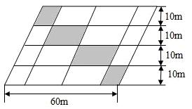

# Mathematics (Grade 5)

**ID**: 7388262d
**难度**: medium_hard
**题型**: multiple_choice

## 题目

(2010•大安区)学校有一块平行四边形试验地，把它分成16块小的平行四边形如图，图中阴影部分种土豆．种土豆的试验地面积是(  )
A．2400$m^{2}$
B．1200$m^{2}$
C．600$m^{2}$
D．60$m^{2}$

## 解答

**答案**: C

1. Step1:观察图形，发现可将每小块阴影部分向上平移
2. Step2:平移后得到一个底为60米，高为10米的平行四边形
3. Step3:根据平行四边形面积公式，面积=底×高，即60×10
4. Step4:计算得出面积为600平方米

## 知识点

**知识点**:
  - 平行四边形的面积．

---
