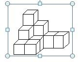

# Mathematics (Grade 5)

**ID**: 74a2ea8c
**难度**: medium_hard
**题型**: multiple_choice

## 题目
如图所示的立方体图形是由（  ）个小立方体组成的．
A．8
B．10
C．11
D．12

## 解答

**答案**: D

1. Step1:观察图形可知其有3层
2. Step2:确定最上面一层小立方体数量为1个
3. Step3:确定中间一层小立方体数量为3个
4. Step4:确定最下面一层小立方体数量为8个
5. Step5:计算小立方体总数为1 + 3 + 8 = 12个
6. Step6:根据选项，答案为D

## 知识点

**知识点**:
  - 组合图形的计数．

---
