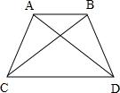

# Mathematics (Grade 5)

**ID**: 75e43ed7
**难度**: medium_hard
**题型**: multiple_choice

## 题目
下图中梯形ABCD的面积是40平方分米，三角形ABC的面积是25平方分米，则三角形BCD的面积是(  )
A．25平方分米
B．15平方分米
C．40平方分米

## 解答

**答案**: B

1. Step1:明确已知条件，梯形ABCD的面积是40平方分米，三角形ABC的面积是25平方分米
2. Step2:分析图形关系，可知三角形BCD的面积等于梯形ABCD的面积减去三角形ABC的面积
3. Step3:进行计算，40 - 25 = 15平方分米
4. Step4:得出结论，三角形BCD的面积是15平方分米，对应选项B

## 知识点

**知识点**:
  - 组合图形的面积;三角形的周长和面积．

---
