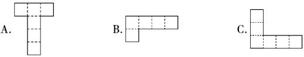

# Mathematics (Grade 5)

**ID**: 781d8cef
**难度**: medium_hard
**题型**: multiple_choice

## 题目
下面的图形中，图（）沿虚线折叠后能围成正方体。

## 解答

**答案**: A

1. Step1:明确正方体展开图有11种类型。
2. Step2:分析A项，发现其满足正方体11种展开图中的“T”型，所以A项沿虚线折叠后能围成正方体。
3. Step3:分析B项，由于长方体有6个面，而B项只有5个面，所以B项沿虚线折叠后不能围成正方体。
4. Step4:分析C项，将其图形折叠起来会有重复的面，所以C项沿虚线折叠后不能围成正方体。

## 知识点

**知识点**:
  - 正方体的展开与折叠

---
