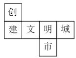

# Mathematics (Grade 5)

**ID**: 810d66f5
**难度**: medium_hard
**题型**: multiple_choice

## 题目
“创建文明城市，构建美丽家园”，福星小区要建一个正方体宣传箱。下图是它的展开图，在宣传箱上与“市”字相对的是（   ）。 

$\begin{description}
\item A．文\item B．建\item C．创\item D．市
\end{description}$

## 解答

**答案**: C

1. Step1:根据正方体展开图的特点，把一个面作为底面，折叠后确定每个面的位置
2. Step2:确定明是底面，文是左面，城是右面，建是上面，创是后面
3. Step3:由此得出市与创相对
4. Step4:在选项中找到与创对应的选项，即选项C

## 知识点

**知识点**:
  - 

---
