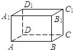

# Mathematics (Grade 5)

**ID**: 87b3a4c8
**难度**: medium_hard
**题型**: multiple_choice

## 题目
如图所示，与棱AD异面的棱有(  )
A．2条
B．3条
C．4条
D．5条

## 解答

**答案**: D

1. Step1:明确异面棱的概念，即不在同一平面内的棱
2. Step2:确定棱AD所在的平面，可看作在下面（平面ABCD）和左面（平面ADD1A1）两个面中
3. Step3:找出不在这两个平面上的棱，分别为BB1、CC1、B1C1、C1D1、A1B1
4. Step4:数出不在这两个平面上的棱的数量为5条
5. Step5:根据选项得出答案为D

## 知识点

**知识点**:
  - 长方体的特征．

---
