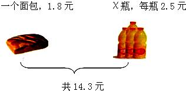

# Mathematics (Grade 5)

**ID**: 889045ea
**难度**: medium_hard
**题型**: multiple_choice

## 题目
看下列图示，图中的x对应的值是（  ）

$\begin{description}
\item A．3\item B．4\item C．5\item D．6
\end{description}$

## 解答

**答案**: C

1. Step1:根据图示可知，存在等量关系为一个面包的钱数+饮料的钱数=14.3元
2. Step2:设饮料有x瓶，因为饮料每瓶2.5元，根据单价×数量=总价，所以饮料的钱数为2.5x元
3. Step3:已知一个面包1.8元，将面包的钱数和饮料的钱数代入等量关系，得到方程1.8 + 2.5x = 14.3
4. Step4:求解方程1.8 + 2.5x = 14.3，先移项可得2.5x = 14.3 - 1.8，即2.5x = 12.5
5. Step5:再求解x，两边同时除以2.5，得到x = 12.5÷2.5 = 5
6. Step6:所以图中的x对应的值是5，答案选C

## 知识点

**知识点**:
  - 列方程解应用题（两步需要逆思考）．

---
