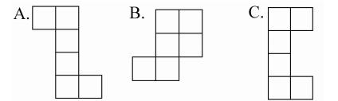

# Mathematics (Grade 5)

**ID**: 8d8efac3
**难度**: medium_hard
**题型**: multiple_choice

## 题目
下列（）图形可以拼成一个正方体。

## 解答

**答案**: A

1. Step1:明确本题是根据正方体展开图特点判断能否拼成正方体
2. Step2:依据正方体展开图的11种特征判断图A，得出图A属于“1-4-1”型
3. Step3:依据正方体展开图的特征判断图B，得出图B属于“田”字型
4. Step4:依据正方体展开图的特征判断图C，得出图C不属于正方体展开图
5. Step5:根据符合正方体展开图特征的图形能折成正方体，不符合的不能折成正方体，得出图A能拼成正方体，图B和图C不能拼成正方体，答案为A

## 知识点

**知识点**:
  - 正方体的展开与折叠

---
