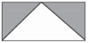

# Mathematics (Grade 5)

**ID**: 906b7fce
**难度**: medium_hard
**题型**: multiple_choice

## 题目
如图， 阴影部分的面积（）空白部分的面积。

A.＞
B.=
C.＜

## 解答

**答案**: B

1. Step1:观察图形，将阴影部分合成一个三角形
2. Step2:发现合成后的阴影三角形与空白部分三角形等底等高
3. Step3:根据三角形面积公式S = 底×高÷2，可知等底等高的三角形面积相等
4. Step4:得出阴影部分的面积等于空白部分的面积，所以答案选B

## 知识点

**知识点**:
  - 

---
