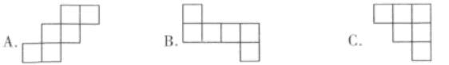

# Mathematics (Grade 5)

**ID**: 9486ad27
**难度**: medium_hard
**题型**: multiple_choice

## 题目
下面图形中不能折叠成正方体的是（）。

## 解答

**答案**: C

1. Step1:明确本题考查正方体的展开和折叠，需依据正方体特征来判断
2. Step2:判断选项A，其图形属于正方体11种展开图中的“2-2-2”型，能折叠成正方体
3. Step3:判断选项B，其图形属于正方体11种展开图中的“1-4-1”型，能折叠成正方体
4. Step4:判断选项C，其图形折叠后有重合的面，不能折叠成正方体
5. Step5:得出不能折叠成正方体的是选项C

## 知识点

**知识点**:
  - 长、正方体的展开与折叠

---
