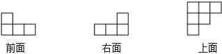

# Mathematics (Grade 5)

**ID**: 9626eec0
**难度**: medium_hard
**题型**: multiple_choice

## 题目
大林用棱长1厘米的小正方体摆成一个物体，从前面、右面和上面分别观察这个物体，看到的形状如图：

这个物体的表面积是（  ）平方厘米．
A．7
B．28
C．14
D．32

## 解答

**答案**: B

1. Step1:根据前面看到的形状，得出前面小正方形的个数为4个
2. Step2:根据右面看到的形状，得出右面小正方形的个数为4个
3. Step3:根据上面看到的形状，得出上面小正方形的个数为6个
4. Step4:将前面、右面、上面小正方形的个数相加，即4 + 4 + 6 = 14个
5. Step5:因为物体的表面积是表面露出小正方形面的总面积，且物体有相对的两面，所以将上述和乘2，得到14×2 = 28个小正方形面
6. Step6:已知小正方体棱长为1厘米，其每个面的面积为1×1 = 1平方厘米
7. Step7:用小正方形面的总个数乘以每个小正方形面的面积，即28×1 = 28平方厘米，所以答案选B

## 知识点

**知识点**:
  - 

---
