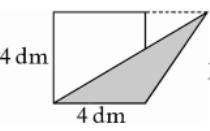

# Mathematics (Grade 5)

**ID**: 9c97ac2d
**难度**: medium_hard
**题型**: multiple_choice

## 题目
左图阴影部分的面积是（）。
A.16dm$^{2}$
B.8dm$^{2}$
C.无法确定

## 解答

**答案**: B

1. Step1:明确阴影部分为三角形
2. Step2:确定该三角形的底为4dm
3. Step3:确定该三角形的高为4dm
4. Step4:根据三角形面积公式S = $rac{1}{2}$ah（其中a为底，h为高），代入a = 4dm，h = 4dm，得到S = $rac{1}{2}$×4×4
5. Step5:计算$rac{1}{2}$×4×4 = 8（dm²）
6. Step6:得出阴影部分面积为8dm²，答案选B

## 知识点

**知识点**:
  - 三角形的面积

---
