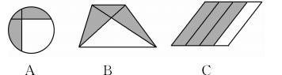

# Mathematics (Grade 5)

**ID**: 9f102573
**难度**: medium_hard
**题型**: multiple_choice

## 题目
下面各图形中，阴影部分表示$\frac{3}{4}$的是（）。

## 解答

**答案**: C

1. Step1:根据分数的意义，把单位“1”平均分成若干份，其中的一份或几份用分数表示。
2. Step2:分析选项A，阴影部分的三份不是平均分的，不符合分数中平均分的要求，不是整个面积的$\frac{3}{4}$，所以阴影部分不能用$\frac{3}{4}$表示。
3. Step3:分析选项B，阴影部分的三份不是平均分的，不符合分数中平均分的要求，不是整个面积的$\frac{3}{4}$，所以阴影部分不能用$\frac{3}{4}$表示。
4. Step4:分析选项C，平行四边形被平均分成4份，阴影部分占其中的3份，符合分数的意义，故阴影部分表示$\frac{3}{4}$。
5. Step5:综上，答案是C。

## 知识点

**知识点**:
  - 分数的意义

---
