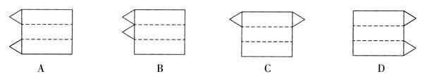

# Mathematics (Grade 5)

**ID**: a7efd580
**难度**: medium_hard
**题型**: multiple_choice

## 题目
下列四个图形可以折叠成棱柱的是（）

## 解答

**答案**: C

1. Step1:明确棱柱的特征，即棱柱的上底与下底分别在侧面的长方形的两边
2. Step2:分析选项A，发现其上底与下底不在侧面长方形的两边，所以A不符合要求
3. Step3:分析选项B，发现其上底与下底不在侧面长方形的两边，所以B不符合要求
4. Step4:分析选项C，其上底与下底在侧面长方形的两边，符合棱柱特征
5. Step5:分析选项D，发现其上底与下底不在侧面长方形的两边，所以D不符合要求
6. Step6:综上，只有C选项符合要求，答案为C

## 知识点

**知识点**:
  - 展开图折叠成几何体

---
