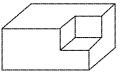

# Mathematics (Grade 5)

**ID**: a9fddc84
**难度**: medium_hard
**题型**: multiple_choice

## 题目
一个长方体被挖一小块（如图），下面说法完全正确的是（）。
A.体积减少，表面积也减少
B.体积减少，表面积增加
C.体积减少，表面积不变

## 解答

**答案**: C

1. Step1:明确体积的定义，物体所占空间的大小叫体积。
2. Step2:因为长方体被挖掉一块，其占的空间变小，所以体积减小。
3. Step3:明确表面积是构成长方体的所有面的面积总和。
4. Step4:由于从长方体上挖掉一小块，构成长方体表面积的面没有变化，所以表面积不变。
5. Step5:根据体积减少和表面积不变，得出答案选C。

## 知识点

**知识点**:
  - 长、正方体体积的计算;长、正方体表面积的计算

---
