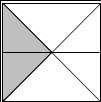

# Mathematics (Grade 5)

**ID**: aa070051
**难度**: medium_hard
**题型**: multiple_choice

## 题目
如图中阴影部分用（  ）表示．

A．$\frac{1}{6}$
B．$\frac{2}{6}$
C．$\frac{1}{4}$

## 解答

**答案**: C

1. Step1:根据解析2的方法，先确定图形平均分成的份数
2. Step2:观察图形可知，正方形被平均分成了4份，这4份作为分母
3. Step3:再数阴影部分的份数，阴影部分占1份，这1份作为分子
4. Step4:所以阴影部分用分数表示为$\frac{1}{4}$，答案选C

## 知识点

**知识点**:
  - 分数的意义、读写及分类．

---
