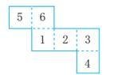

# Mathematics (Grade 5)

**ID**: aed495ae
**难度**: medium_hard
**题型**: multiple_choice

## 题目
如图是一个正方体的展开图，与4号面相对的面是（）号面。

## 解答

**答案**: 6

1. Step1:明确正方体平面展开图的性质，即相邻的面不相对，相对的面不相邻
2. Step2:根据在正方体平面图上相对的面一般相隔一个相同的面这一特点，观察给定的正方体展开图
3. Step3:发现与4号面相隔一个面的是6号面，所以得出与4号面相对的面是6号面

## 知识点

**知识点**:
  - 正方体的展开与折叠

---
