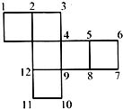

# Mathematics (Grade 5)

**ID**: b3935e0b
**难度**: medium_hard
**题型**: multiple_choice

## 题目
如图是一个正方体纸盒的展开图，当还原折成纸盒时，与点1重合的点是点(  )
A．6和11
B．6和10
C．7和11
D．7和10

## 解答

**答案**: C

1. Step1:观察正方体纸盒展开图，明确要找与点1重合的点
2. Step2:根据正方体展开图特征，思考折叠后点的重合情况
3. Step3:发现1点所在的正方形分别和点7、点11所在的2个正方形相交
4. Step4:得出折叠成正方体后1点与点7和点11重合的结论
5. Step5:根据上述结论，从选项中选择C

## 知识点

**知识点**:
  - 正方体的展开图．

---
