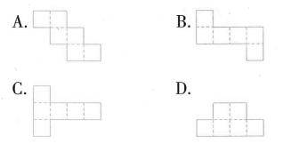

# Mathematics (Grade 5)

**ID**: b8686af0
**难度**: medium_hard
**题型**: multiple_choice

## 题目
下列图形中，（）不能折成正方体。

## 解答

**答案**: D

1. Step1:明确正方体展开图有“141型”（中间一行4个作侧面，上下两个各作为上下底面，共6种基本图形）、“132型”（中间3个作侧面，共3种基本图形）、“222型”（1种，两行只能有1个正方形相连）、“33型”（1种，两行只能有1个正方形相连）这4种类型
2. Step2:判断时，当是132型、222型时要注意不能出现田字形
3. Step3:分析选项A，其图形符合正方体展开图特征，能折成正方体
4. Step4:分析选项B，其图形符合正方体展开图特征，能折成正方体
5. Step5:分析选项C，其图形符合正方体展开图特征，能折成正方体
6. Step6:分析选项D，其图形出现了“田”字，不符合正方体展开图特征，不能折成正方体

## 知识点

**知识点**:
  - 长、正方体的展开与折叠

---
