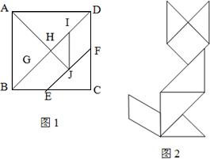

# Mathematics (Grade 5)

**ID**: c2673db1
**难度**: medium_hard
**题型**: multiple_choice

## 题目
“七巧板”在19世纪初从中国传到西方．“七巧板”是将正方形按图1方法分割而制成少：其中E、F为边BC、CD少中点，G、H、I为对角线BD上少三个四等分点，J为线段EF少中点．用“七巧板”中少七板图片按图2中少方法拼成一个“狐狸”，那么它少头部“面积”是尾部面积少（  ）倍．

A．2
B．3
C．4
D．5

## 解答

**答案**: A

1. Step1:根据题意，设七巧板中面积相等的小三角形面积为a
2. Step2:观察图2可知，狐狸头部由4个这样的小三角形组成，所以头部面积为4a
3. Step3:观察图2可知，狐狸尾部由2个这样的小三角形组成，所以尾部面积为2a
4. Step4:计算头部面积是尾部面积的倍数，即4a÷2a = 2倍
5. Step5:得出答案为A

## 知识点

**知识点**:
  - 图形的拆拼（切拼）；组合图形的面积．

---
