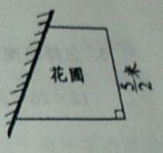

# Mathematics (Grade 5)

**ID**: c7e2d70b
**难度**: medium_hard
**题型**: multiple_choice

## 题目
王大伯用一根长
 $\frac{17}{2}$
  米的栅栏靠墙边围成了一个梯形花圃(如图)，这个花圃的面积是(    )
 A.18平方米
$B.\frac{15}{2}平方米$
 C.无法确定

$\frac{5}{2}米$

## 解答

**答案**: B

1. Step1:明确栅栏长度为$\frac{17}{2}$米，梯形的高为$\frac{5}{2}$米，且靠墙围花圃，所以梯形上下底之和等于栅栏长度减去高
2. Step2:计算梯形上下底之和，$\frac{17}{2} - \frac{5}{2}=6$米
3. Step3:根据梯形面积公式$S=(上底 + 下底)×高÷2$，代入上下底之和$6$米与高$\frac{5}{2}$米，计算面积$S = \frac{1}{2}×6×\frac{5}{2}=\frac{15}{2}$平方米
4. Step4:得出答案为$\frac{15}{2}$平方米，对应选项B

## 知识点

**知识点**:
  - 

---
