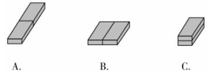

# Mathematics (Grade 5)

**ID**: c95030aa
**难度**: medium_hard
**题型**: multiple_choice

## 题目
下面的拼法中表面积最大的是（）

## 解答

**答案**: A

1. Step1:明确两个长方体拼在一起时，新图形的表面积是两个长方体表面积之和减去两个重合部分的面积
2. Step2:分析选项A，其表面积是两个长方体表面积之和减去两个最小的面的面积
3. Step3:分析选项B，其表面积是两个长方体表面积之和减去两个侧面的面积
4. Step4:分析选项C，其表面积是两个长方体表面积之和减去两个最大的面的面积
5. Step5:因为表面积最大的情况是重合部分面积最小，而选项A重合的是最小的面，所以选项A拼法中表面积最大

## 知识点

**知识点**:
  - 长方体和正方体的表面积

---
