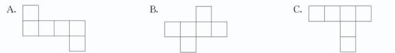

# Mathematics (Grade 5)

**ID**: cafc3d33
**难度**: medium_hard
**题型**: multiple_choice

## 题目
下面所给的图形中，不能折成正方体的是（）。

## 解答

**答案**: C

1. Step1:明确正方体展开图有11种情况，其中“1-4-1”型是常见可折成正方体的类型
2. Step2:观察A图形，判断其符合“1-4-1”型的结构图，所以A可以折成正方体
3. Step3:观察B图形，判断其符合“1-4-1”型的结构图，所以B可以折成正方体
4. Step4:观察C图形，发现有4个正方形连在一起，另外两个正方形在同侧，不满足正方体展开图的常见结构，所以C不能折成正方体

## 知识点

**知识点**:
  - 长、正方体的展开与折叠

---
