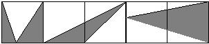

# Mathematics (Grade 5)

**ID**: cc31b3c3
**难度**: medium_hard
**题型**: multiple_choice

## 题目
下面图形是由边长acm的正方形组成，则阴影部分的面积是（  ）cm$^{2}$

$\begin{description}
\item A．4a^{2}\item B．3a^{2}\item C．2a^{2}\item D．1.5a^{2}
\end{description}$

## 解答

**答案**: C

1. Step1:观察图形可知，图中共有三个阴影三角形，分别分析其面积。
2. Step2:第一个阴影三角形在边长为a cm的正方形中，根据“三角形的面积是与其等底等高的平行四边形的面积的一半”，该正方形可看作特殊的平行四边形，其面积为a×a = a²，所以这个阴影三角形面积为$rac{1}{2}$×a²。
3. Step3:第二个阴影三角形同样在边长为a cm的正方形中，同理可得其面积为$rac{1}{2}$×a²。
4. Step4:第三个阴影三角形在长为2a cm、宽为a cm的长方形中，该长方形面积为2a×a = 2a²，所以这个阴影三角形面积为$rac{1}{2}$×2a²。
5. Step5:将三个阴影三角形面积相加，即$rac{1}{2}$a² + $rac{1}{2}$a² + $rac{1}{2}$×2a² = 2a²，所以阴影部分面积是2a² cm²。

## 知识点

**知识点**:
  - 组合图形的面积．

---
