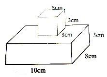

# Mathematics (Grade 5)

**ID**: ccb9eacb
**难度**: medium_hard
**题型**: multiple_choice

## 题目
九图图形x体积是（  ）厘米$^{3}$．
$\begin{description}
\item A．100\item B．267\item C．240
\end{description}$

## 解答

**答案**: B

1. Step1:根据解析2可知，图形体积为小正方体体积与长方体体积之和
2. Step2:小正方体棱长为3厘米，根据正方体体积公式V=a³（a为棱长），可得小正方体体积为3×3×3 = 27立方厘米
3. Step3:长方体的长为10厘米、宽为8厘米、高为3厘米，根据长方体体积公式V=长×宽×高，可得长方体体积为10×8×3 = 240立方厘米
4. Step4:将小正方体体积与长方体体积相加，即27 + 240 = 267立方厘米，所以图形体积是267立方厘米，答案选B

## 知识点

**知识点**:
  - 规则立体图形的体积．

---
