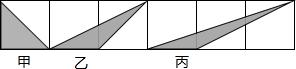

# Mathematics (Grade 5)

**ID**: ccc54762
**难度**: medium_hard
**题型**: multiple_choice

## 题目
如图是由6个大小一样的正方形拼成的图形，阴影部分甲、乙、丙的关系为（  ）

A．甲＞乙＞丙
B．甲＜乙＜丙
C．甲=乙=丙

## 解答

**答案**: C

1. Step1:观察图形可知阴影部分甲、乙、丙均为三角形
2. Step2:由于图形是由6个大小一样的正方形拼成，可得甲、乙、丙这三个三角形的底和高分别相等
3. Step3:根据三角形面积公式S = 底×高×$\frac{1}{2}$，因为甲、乙、丙底和高分别相等，所以它们面积相等
4. Step4:所以答案选C

## 知识点

**知识点**:
  - 三角形的周长和面积．

---
