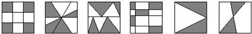

# Mathematics (Grade 5)

**ID**: d2aab0f1
**难度**: medium_hard
**题型**: multiple_choice

## 题目
各图中的阴影部分，能用分数$\frac{1}{2}$表示的有(  )个．

A．1个
B．2个
C．3个
D．4个

## 解答

**答案**: C

1. Step1:明确分数的意义，即把单位“1”平均分成若干份，表示其中一份或几份的数。
2. Step2:观察第一个图形，其阴影部分不是将图形平均分成两份得到的，所以不能用分数$\frac{1}{2}$表示。
3. Step3:观察第二个图形，其将图形平均分成了两份，阴影部分占一份，能用分数$\frac{1}{2}$表示。
4. Step4:观察第三个图形，其将图形平均分成了两份，阴影部分占一份，能用分数$\frac{1}{2}$表示。
5. Step5:观察第四个图形，其阴影部分不是将图形平均分成两份得到的，所以不能用分数$\frac{1}{2}$表示。
6. Step6:观察第五个图形，其将图形平均分成了两份，阴影部分占一份，能用分数$\frac{1}{2}$表示。
7. Step7:观察第六个图形，其阴影部分不是将图形平均分成两份得到的，所以不能用分数$\frac{1}{2}$表示。
8. Step8:统计能用分数$\frac{1}{2}$表示的图形个数为3个。

## 知识点

**知识点**:
  - 分数的意义、读写及分类．

---
