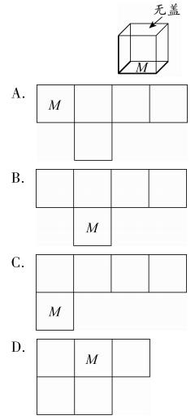

# Mathematics (Grade 5)

**ID**: d77d5875
**难度**: medium_hard
**题型**: multiple_choice

## 题目
如图，有一个无盖的正方体纸盒，下底面标有字母“M”，沿图中粗线将其剪开展成平面图形，想一想，这个平面图形是（）。

## 解答

**答案**: B

1. Step1:根据题意，将正方体纸盒剪开并展开成平面图形后，观察到底面M的一侧有一个正方形，且在这个正方形的左侧还有一个正方形，由此排除选项C。
2. Step2:依据正方体展开图的特征，D选项中出现“田”字，不符合要求，所以排除D。
3. Step3:由于该正方体是无盖的，A选项经过折叠后M的对面有盖，不符合题意，故排除A。
4. Step4:综上，只有B选项符合所有条件，所以答案是B。

## 知识点

**知识点**:
  - 长、正方体的展开与折叠

---
