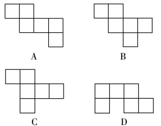

# Mathematics (Grade 5)

**ID**: db5130b9
**难度**: medium_hard
**题型**: multiple_choice

## 题目
下面的平面图中，（ ）不能折成正方体。

## 解答

**答案**: D

1. Step1:明确本题是判断平面图能否折成正方体的问题，需依据正方体展开图的结构来判断。
2. Step2:分析选项A，其展开图属于正方体展开图中的“一三二”结构，所以能折成正方体。
3. Step3:分析选项B，其展开图是正方体的展开图，因此能折成正方体。
4. Step4:分析选项C，其展开图是正方体的展开图，故能折成正方体。
5. Step5:分析选项D，其图形不属于正方体的展开图，所以不能折成正方体。
6. Step6:综上，不能折成正方体的是选项D，答案为['D']。

## 知识点

**知识点**:
  - 正方体的展开与折叠

---
