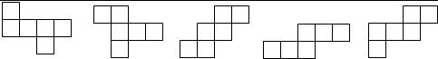

# Mathematics (Grade 5)

**ID**: dca65823
**难度**: medium_hard
**题型**: multiple_choice

## 题目
如图图形中，由正方体展开而得到的图形有(  )个．

A．2
B．3
C．4
D．5

## 解答

**答案**: D

1. Step1:明确正方体展开图的类型有1-4-1型，2-3-1型，2-2-2型，3-3型
2. Step2:判断图1是1-4-1型，属于正方体展开图
3. Step3:判断图2是2-3-1型，属于正方体展开图
4. Step4:判断图3是2-2-2型，属于正方体展开图
5. Step5:判断图4是3-3型，属于正方体展开图
6. Step6:判断图5是2-3-1型，属于正方体展开图
7. Step7:统计属于正方体展开图的个数为5个

## 知识点

**知识点**:
  - 正方体的展开图．

---
