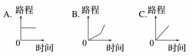

# Mathematics (Grade 5)

**ID**: dcda7526
**难度**: medium_hard
**题型**: multiple_choice

## 题目
张跃步行去上学，走了一段路后，发现快迟到了，就加快了脚步。下图中（）能反映他的运动过程。

## 解答

**答案**: B

1. Step1:明确张跃的运动情况是先走一段路，然后加快脚步，速度由慢到快，离家距离越来越远
2. Step2:观察三幅折线统计图，图A路程不变，不符合张跃离家距离越来越远的情况，排除图A
3. Step3:因为张跃速度先慢后快，在路程 - 时间统计图中，速度快慢反映为折线的倾斜程度，倾斜程度越大速度越快，图B折线前期倾斜程度小后期倾斜程度大，符合速度先慢后快，图C折线倾斜程度不变，速度不变，不符合，所以图B能反映他的运动过程

## 知识点

**知识点**:
  - 单式折线统计图;简单的行程问题

---
