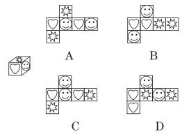

# Mathematics (Grade 5)

**ID**: e1779ab5
**难度**: medium_hard
**题型**: multiple_choice

## 题目
笑笑制作了一个如图所示的正方体礼品盒，其对面图案都相同，那么这个正方体礼品盒可能是由平面图形（）折叠成的。

## 解答

**答案**: A

1. Step1:明确正方体礼品盒的对面图案都相同这一条件
2. Step2:根据对面图案相同推出展开图中相邻图案不相同
3. Step3:依次分析选项，判断哪个选项中相邻图案不相同，A选项符合该条件
4. Step4:得出答案为A

## 知识点

**知识点**:
  - 长、正方体的展开与折叠

---
