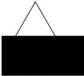

# Mathematics (Grade 5)

**ID**: e3a41ff1
**难度**: medium_hard
**题型**: multiple_choice

## 题目
(如图)被长方形盖住的图形，可能是(  )三角形．

A．锐角
B．直角
C．钝角
D．都有可能

## 解答

**答案**: D

1. Step1:明确已知条件，图中显示的三角形只露出一个锐角，其余部分被长方形盖住
2. Step2:根据三角形的分类知识，仅知道一个角是锐角时，其他角的情况不确定
3. Step3:分析其他角的可能性，其他角可能有钝角，此时为钝角三角形；可能有直角，此时为直角三角形；也可能都是锐角，此时为锐角三角形
4. Step4:得出结论，被长方形盖住的图形可能是锐角三角形、直角三角形或钝角三角形，所以答案选D

## 知识点

**知识点**:
  - 三角形的分类．

---
