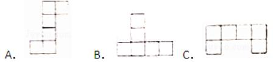

# Mathematics (Grade 5)

**ID**: eca4c134
**难度**: medium_hard
**题型**: multiple_choice

## 题目
下面三个图形中，（）可以折成一个正方体。

## 解答

**答案**: A

1. Step1:明确正方体展开图的结构有“1-4-1”的6个、“1-3-2”的3个、“3-3”的1个、“2-2-2”的1个这四种类型
2. Step2:判断图A是“1-4-1”结构，符合正方体展开图特征，能折成正方体
3. Step3:判断图B不符合正方体展开图的特征，不是正方体的展开图，不能折成正方体
4. Step4:判断图C不符合正方体展开图的特征，不是正方体的展开图，不能折成正方体
5. Step5:得出可以折成正方体的图形是A

## 知识点

**知识点**:
  - 长、正方体的展开与折叠

---
