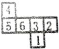

# Mathematics (Grade 5)

**ID**: edbd24f1
**难度**: medium_hard
**题型**: multiple_choice

## 题目
下图是正方体展开图，与数字1相对的面数字是（   ）。

A．4
B．2
C．5
D．6

## 解答

**答案**: A

1. Step1:明确此正方体展开图是1－4－1型
2. Step2:根据1－4－1型展开图特点，上下两个是相对面，中间每相隔一格是相对面
3. Step3:观察展开图，确定4和1是相对面，5和3是相对面，6和2是相对面
4. Step4:得出与数字1相对的面数字是4，答案选A

## 知识点

**知识点**:
  - 

---
