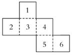

# Mathematics (Grade 5)

**ID**: f16a108d
**难度**: medium_hard
**题型**: multiple_choice

## 题目
将下图中的硬纸片沿虚线折起来，便可成为一个正方体。这个正方体3号面的对面是（）号面。

A.1
B.6
C.5

## 解答

**答案**: B

1. Step1:明确本题是关于正方体展开图折叠后确定相对面的问题
2. Step2:假设标有数字5的面为底面
3. Step3:将其他面进行折叠得到正方体
4. Step4:观察折叠后的正方体，确定1和5相对、2和4相对、3和6相对
5. Step5:得出3号面的对面是6号面，答案为B

## 知识点

**知识点**:
  - 长、正方体的展开与折叠

---
