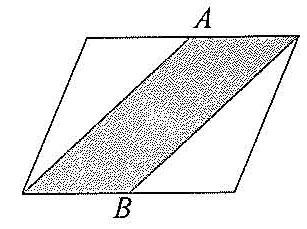

# Mathematics (Grade 5)

**ID**: f4553a5a
**难度**: medium_hard
**题型**: multiple_choice

## 题目
如图，已知A，B是平行四边形上、下两边的中点，空白部分的面积之和是15平方厘米，阴影部分的面积（    ）15平方厘米.
   A．大于
   B. 小于
   C．等于

## 解答

**答案**: C

1. Step1:因为A，B是平行四边形上、下两边的中点，所以可将平行四边形分割成多个部分进行分析
2. Step2:根据三角形面积是与其等底等高的平行四边形面积的一半这一性质，可发现空白部分的两个三角形与阴影部分的平行四边形存在面积关系
3. Step3:通过分析得出阴影部分面积和空白部分面积之和是相等的
4. Step4:已知空白部分的面积之和是15平方厘米，所以阴影部分的面积等于15平方厘米，故答案选C

## 知识点

**知识点**:
  - 单元科学能力测评卷（六A）、（六B）--

---
