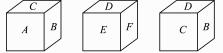

# Mathematics (Grade 5)

**ID**: f8de67f2
**难度**: medium_hard
**题型**: multiple_choice

## 题目
一个正方体的6个面上分别写着A、B、C、D、E、F这6个字母，下图是这个正方体的不同摆放，A的对面是什么？

## 解答

**答案**: D

1. Step1:观察图2和图3，确定与D相邻的四个面分别是E、F、B、C
2. Step2:因为正方体有6个面，已知与D相邻的四个面，所以剩下的面就是D的对面
3. Step3:由于正方体6个面分别是A、B、C、D、E、F，除了与D相邻的E、F、B、C，剩下的A就是D的对面

## 知识点

**知识点**:
  - 正方体的展开与折叠

---
