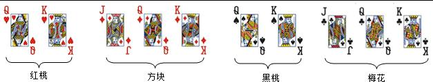

# Mathematics (Grade 5)

**ID**: fd7bb7b4
**难度**: medium_hard
**题型**: multiple_choice

## 题目
如下图，把10张扑克牌洗一下，反扣在桌面上，从中任意摸一张．摸到方块的可能性是(  )

A．$\frac{3}{10}$
B．$\frac{1}{4}$
C．$\frac{1}{2}$
D．$\frac{3}{7}$

## 解答

**答案**: A

1. Step1:明确扑克牌的总数，通过计算2 + 3 + 2 + 3 = 10张
2. Step2:确定方块牌的数量为3张
3. Step3:根据可能性的计算方法，用方块牌的数量除以扑克牌的总数，即3÷10
4. Step4:得出摸到方块的可能性为$rac{3}{10}$

## 知识点

**知识点**:
  - 简单事件发生的可能性求解．

---
