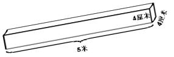

# Mathematics (Grade 5)

**ID**: 003ff948
**难度**: medium_hard
**题型**: short_answer

## 题目
一根长方体方钢，长是5米，横截面是一个边长为4厘米的正方形，如果每立方厘米钢重0.0079千克，这根方钢重多少千克？

## 解答

**答案**: 63.2

1. Step1:将方钢的长5米换算为厘米，因为1米 = 100厘米，所以5米 = 5×100 = 500厘米
2. Step2:根据正方形面积公式S = a×a，其中a = 4厘米，求出方钢的横截面积为4×4 = 16平方厘米
3. Step3:用横截面积乘以方钢的长求出方钢体积，即16×500 = 8000立方厘米
4. Step4:用每立方厘米钢的重量0.0079千克乘以方钢体积8000立方厘米，即8000×0.0079 = 63.2千克

## 知识点

**知识点**:
  - 长、正方体体积的计算

---
